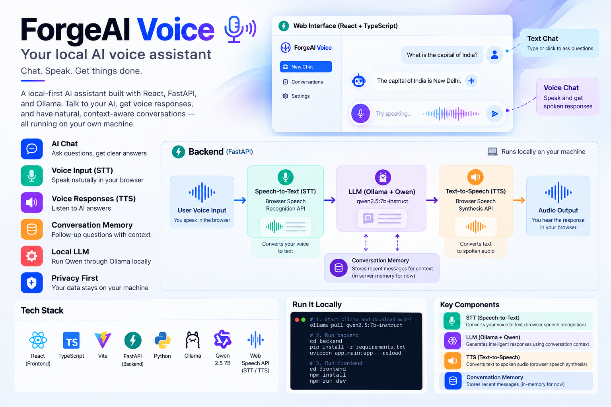

# ForgeAI Voice 🎙️



I've been working on ForgeAI Voice as a side project to explore how to build a voice-based AI assistant from scratch.

The idea is simple: I should be able to talk to my assistant, ask questions, ask follow-up questions without repeating the context, and eventually get it to perform useful tasks.

I'm running the LLM locally using Ollama and Qwen, with a Python backend and a React-based web interface.

## What it can do right now

- Chat with an AI assistant through a web interface.
- Ask questions using your voice.
- Hear the assistant's responses.
- Continue a conversation without losing the context of earlier messages.
- Run the language model locally on my machine.

## How it works

The frontend is built with React and TypeScript. It sends messages to a FastAPI backend, which passes the conversation to Qwen running through Ollama.

For voice interaction, I'm currently using the browser's built-in speech recognition and speech synthesis APIs.

```text
React + TypeScript
        |
        v
   FastAPI Backend
        |
        v
   Ollama + Qwen
```

## Tech stack

- **Frontend:** React, TypeScript, Vite
- **Backend:** Python, FastAPI
- **LLM:** Qwen 2.5 7B Instruct
- **Model runtime:** Ollama
- **Voice:** Browser speech APIs

## Run it locally

You'll need Python, Node.js, npm, and Ollama installed.

First, clone the repository:

```bash
git clone https://github.com/pushpenmahawar/ForgeAI-Voice.git
cd ForgeAI-Voice
```

Download the model:

```bash
ollama pull qwen2.5:7b-instruct
```

Start the backend:

```bash
cd backend
python3 -m venv .venv
source .venv/bin/activate
pip install -r requirements.txt
python -m uvicorn app.main:app --reload --port 8000
```

Open another terminal and start the frontend:

```bash
cd ~/ForgeAI-Voice/frontend
npm install
npm run dev
```

Open http://localhost:5173 in your browser.

The backend API documentation is available at http://localhost:8000/docs.

## What's next?

This is still a work in progress. Some things I want to explore next:

- Better conversation memory that survives backend restarts.
- Improving voice response time.
- Trying local speech-to-text and text-to-speech models.
- Giving the assistant tools so it can do more than answer questions.
- Adding web search and other useful capabilities.

I'm building this step by step, testing each feature before moving on to the next.

## Feedback

If you're exploring local LLMs, voice agents, or AI application development, feel free to check out the code and share suggestions.

**Repository:** https://github.com/pushpenmahawar/ForgeAI-Voice
